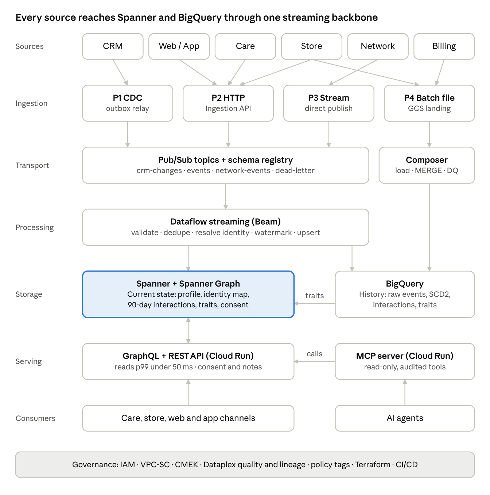

# Customer Data Platform (CDP) — High-Level Architecture

Oct 18, 2026 · Arun

## 1. Document control

Version 0.1 is a first draft for architecture review. It describes a reference CDP built on Google Cloud, using synthetic telco data.

| Field | Value |
| --- | --- |
| Document | CDP High-Level Architecture (HLD) |
| Version | 0.1 (Draft for review) |
| Owner | Data Architect, CDP |
| Reviewers | To be assigned: platform engineering, security, analytics, AI/ML |
| Related documents | ADR log, Low-Level Design per component, Runbook (to follow) |

**Change history**

| Version | Change |
| --- | --- |
| 0.1 | Initial draft: sources, ingestion, data stores, flows, serving, governance, NFRs |

## 2. Executive summary

The CDP collects customer data from 6 source systems and resolves it into one profile per person. It serves that profile to agents, apps and AI agents with p99 read latency under 50 ms. Behavioural signals become visible in under 5 minutes.

The design rests on four choices:

- **Spanner** holds current customer state and serves low-latency reads.
- **BigQuery** holds full history and computes traits and scores.
- **Pub/Sub + Dataflow** form the single streaming backbone; 6 sources enter through 4 standard ingestion patterns.
- **GraphQL** serves applications, and an **MCP server** serves AI agents, both on Cloud Run.

**In scope**

- Ingestion from CRM, web/app clickstream, care, store, network and billing
- Identity resolution, Customer 360 profile, customer knowledge graph
- Serving APIs (GraphQL, REST commands, MCP)
- Governance, security, observability, IaC, CI/CD

**Out of scope**

- Systems of record for customer creation (CRM and billing stay the masters)
- Azure-to-GCP migration of existing workloads
- Marketing campaign execution and Next Best Action model training (the CDP feeds them)

## 3. Business context and goals

Customer data is split across CRM, digital, care, retail, network and billing systems, and no channel sees the whole customer. The goal: any agent, store associate, digital channel or AI agent sees the customer's prior interactions and continues from there.

| CDP capability | What it does | Example |
| --- | --- | --- |
| Collect | Ingests events and records from all sources, streaming and batch | Chat transcript events, daily billing file |
| Identify | Resolves cookies, phones, emails and account IDs to one person | Cookie + phone + email resolve to one customer ID |
| Unify | Maintains one Customer 360 profile with recent interactions | Plan, devices, last 10 touchpoints |
| Compute | Derives traits and scores from history | Churn risk, upgrade eligibility, segment |
| Activate | Serves context to channels and AI agents | Care screen, Next Best Action, MCP tools |
| Govern | Enforces consent, PII protection, quality and lineage | Do-not-market flag respected everywhere |

**Success measures**

| Measure | Target |
| --- | --- |
| Profile read latency (API) | p99 < 50 ms |
| Signal latency (event to profile) | < 5 minutes, p95 |
| Identity resolution quality | Precision ≥ 95%, recall ≥ 90% (measured against ground truth) |
| Serving availability | 99.95% monthly |
| Profiles supported | Designed for 100M+; reference build at 1M |

## 4. Requirements

The platform must meet 10 functional and 10 non-functional requirements. The latency and freshness targets drive most design choices.

**Functional requirements**

| ID | Requirement |
| --- | --- |
| FR-01 | Ingest CDC, HTTP events, webhooks, direct streams and batch files from 6 sources |
| FR-02 | Validate every event against a registered schema; route invalid events to a dead-letter topic |
| FR-03 | Deduplicate events so each `event_id` is applied once |
| FR-04 | Resolve identifiers (cookie, phone, email, account, MSISDN) to a single customer ID |
| FR-05 | Maintain a current Customer 360 profile with the last 90 days of interactions |
| FR-06 | Keep full history in BigQuery, including SCD Type 2 for customer attributes |
| FR-07 | Compute traits and scores and publish them back to the profile |
| FR-08 | Serve profiles through GraphQL, accept CDP-owned commands (consent, preferences, notes) through REST |
| FR-09 | Expose read-only customer context to AI agents through an MCP server |
| FR-10 | Support replay of any stream for up to 7 days from Pub/Sub, and longer from the raw archive |

**Non-functional requirements**

| ID | Category | Target |
| --- | --- | --- |
| NFR-01 | Read latency | p99 < 50 ms at the API, at reference load |
| NFR-02 | Signal freshness | Event visible in profile < 5 min (p95) |
| NFR-03 | Ingestion throughput | Reference 2,000 events/s sustained, 5x burst; design for 100k events/s |
| NFR-04 | Availability | 99.95% for serving APIs; 99.9% for ingestion |
| NFR-05 | Durability | Zero accepted-event loss (acknowledged = persisted in Pub/Sub) |
| NFR-06 | Recovery | RPO 0 for Spanner (multi-region); RTO < 1 hour for pipelines |
| NFR-07 | Scale | 100M+ profiles, multi-TB Spanner, PB-scale BigQuery |
| NFR-08 | Security | Encryption with CMEK, VPC-SC perimeter, least-privilege IAM, PII masked by default |
| NFR-09 | Privacy | Consent enforced at serving time; deletion requests honoured across all stores |
| NFR-10 | Operability | Everything in Terraform; SLOs and alerts on every component |

## 5. Assumptions and constraints

The CDP is a downstream consolidator, not a system of record for customer creation.

**Assumptions**

- A-01: CRM and billing remain the masters for customer, account and bill data; the CDP ingests from them.
- A-02: Source systems can emit CDC, HTTP events or daily files; none require the CDP to pull from their databases directly.
- A-03: Sources send raw identifiers only; the CDP owns resolution to a customer ID.
- A-04: Source data is synthetic for the reference build, generated from a seeded ground-truth "world".
- A-05: A single primary GCP region serves the reference build; production uses a multi-region Spanner configuration.

**Constraints**

- C-01: Google Cloud only (Spanner, BigQuery, Pub/Sub, Dataflow, Cloud Run, Composer, Dataplex).
- C-02: All infrastructure provisioned through Terraform; no manual console changes.
- C-03: PII never appears in logs or in non-production environments unmasked.
- C-04: Reference-build cost kept low: smallest Spanner instance (100 processing units), one Dataflow worker, runtime stack destroyed when not in use.

## 6. Architecture overview

The platform has six layers: sources, ingestion, transport, processing, storage and serving, with governance across all of them. Spanner is the serving system of record; BigQuery holds history and computes traits.



Streaming sources reach Pub/Sub through patterns P1 to P3, and batch files go through Composer (P4). Dataflow writes current state to Spanner and history to BigQuery; computed traits flow back to Spanner. Channels and AI agents read only through the APIs, never from the stores directly.

## 7. Source systems and ingestion patterns

Six source systems enter the CDP through four standard ingestion patterns, so a new source plugs into an existing path instead of a new pipeline.

**Source catalogue**

| Source | Represents | Identifiers it carries | Key data | Pattern | Reference rate |
| --- | --- | --- | --- | --- | --- |
| CRM | Customer master (e.g. Salesforce, Amdocs) | crm_customer_id, name, email, phone, account_id | Customer, account, lines, devices, plan | P1 CDC | On change |
| Web / App | Website and mobile app | cookie_id; email after login | page_view, search, add_to_cart, checkout | P2 HTTP | ~500 events/s |
| Care | Contact centre platform (call, chat), vendor format | Caller phone; sometimes account_id | Contact start/end, intent, case, agent notes | P3 Stream | ~20 events/s |
| Store | Retail point of sale | Phone or email, keyed in by staff | Visit, purchase, return | P2 HTTP + P4 file | ~5 events/s + daily file |
| Network | Network monitoring | MSISDN, IMSI | dropped_call, slow_data, outage_impact | P3 Stream | ~1,000 events/s |
| Billing | Billing system | account_id | Bill amount, due date, payment, late payment | P4 File | 1 file/day |

**Ingestion patterns**

| Pattern | Entry point | Used by | Response to sender |
| --- | --- | --- | --- |
| P1 CDC | Transactional outbox in the source DB, relayed to Pub/Sub `crm-changes` | CRM | None (asynchronous) |
| P2 HTTP | Ingestion API on Cloud Run: auth, schema check, enrich, publish | Web/App, Store visits | `202 Accepted` + event_id; `400` on schema failure |
| P3 Stream | Platform publishes to its own Pub/Sub topic in its own format (`vendor-care-ctr`, `network-events`); a per-source adapter in the pipeline maps it to the canonical envelope | Care, Network | Pub/Sub publish ack |

The sender decides the pattern: platforms that can publish to a stream use P3; browsers, apps and store devices, which cannot hold cloud credentials, use the P2 Ingestion API; webhooks are used only for SaaS sources that cannot stream. Every live feed is backed by a nightly API reconciliation.
| P4 Batch file | GCS landing bucket `gs://cdp-landing/<source>/dt=YYYY-MM-DD/`, Composer-triggered load | Billing, Store end-of-day | Load status in the control table |

**Event envelope (all streaming patterns)**

Every event carries `event_id` (dedupe key), `event_type`, `schema_version`, `event_ts` (when it happened), `received_ts`, `source`, an `identifiers` map and a `payload`. Schemas are Avro, registered on each Pub/Sub topic, and may only evolve in backward-compatible ways.

**Mocking approach (reference build)**

A seeded generator creates a hidden ground-truth world of households, people, accounts, lines and devices. A journey engine drives connected behaviour across sources, for example dropped calls, then a network-issues page view, then a chat, then a store visit. Each mock exposes only what its real system would know. Configurable fault injection adds duplicates, late events, typos, duplicate CRM records, invalid records, a mid-run schema change and missing or repeated daily files. The ground truth is kept so identity resolution can be scored.

## 8. Data architecture

Spanner answers "what is true now". BigQuery answers "what happened". GCS keeps the raw record for replay.

**Data placement**

| Store | Holds | Retention | Why this store |
| --- | --- | --- | --- |
| Spanner | Customer profile, identity map, recent interactions, latest traits, consent, relationship entities | Interactions 90 days (TTL); profile current only | Single-digit-ms keyed reads, strong consistency, transactions, change streams |
| Spanner Graph | Graph view over the same tables: person, account, line, device, household | Same as Spanner | Graph queries without a second database to sync |
| BigQuery | Raw events, interactions, customer history (SCD2), traits, identity history | 7 years (raw: 400 days) | Low-cost columnar history, SQL analytics, ML features |
| GCS | Raw event archive (Avro), landed batch files | 400 days, then Archive class | Replay source of last resort, cheapest storage |

**Spanner schema (serving)**

```sql
CREATE TABLE Customer (
  customer_id STRING(36) NOT NULL,     -- UUIDv4: spreads writes, no hotspot
  status STRING(16), plan_code STRING(32),
  email_hash STRING(64), phone_hash STRING(64),
  updated_at TIMESTAMP OPTIONS (allow_commit_timestamp = true)
) PRIMARY KEY (customer_id);

CREATE TABLE Interaction (
  customer_id STRING(36) NOT NULL,
  event_ts TIMESTAMP NOT NULL,
  event_id STRING(36) NOT NULL,
  channel STRING(16), event_type STRING(64), intent STRING(64), summary STRING(MAX)
) PRIMARY KEY (customer_id, event_ts DESC, event_id),
  INTERLEAVE IN PARENT Customer ON DELETE CASCADE,
  ROW DELETION POLICY (OLDER_THAN(event_ts, INTERVAL 90 DAY));

CREATE TABLE Trait   (customer_id STRING(36) NOT NULL, trait_name STRING(64) NOT NULL, value JSON, computed_at TIMESTAMP)
  PRIMARY KEY (customer_id, trait_name), INTERLEAVE IN PARENT Customer ON DELETE CASCADE;

CREATE TABLE Consent (customer_id STRING(36) NOT NULL, purpose STRING(32) NOT NULL, granted BOOL, updated_at TIMESTAMP)
  PRIMARY KEY (customer_id, purpose), INTERLEAVE IN PARENT Customer ON DELETE CASCADE;

CREATE TABLE IdentityMap (
  id_type STRING(16) NOT NULL,         -- phone | email | cookie | account | msisdn
  id_value_hash STRING(64) NOT NULL,
  customer_id STRING(36) NOT NULL, confidence FLOAT64, last_seen TIMESTAMP
) PRIMARY KEY (id_type, id_value_hash);

CREATE INDEX IdentityByCustomer ON IdentityMap(customer_id);
```

Key design rules:

- Random UUID primary keys spread writes across splits; sequential IDs or timestamps never lead a key.
- Interactions, traits and consent are interleaved under Customer, so one profile read touches one split.
- `event_ts DESC` returns the newest interactions first without sorting.
- IdentityMap is a root table because lookups start from an identifier, not a customer ID.
- Identifiers are stored as salted hashes; clear-text PII lives only in tables guarded by fine-grained access control.
- Account, Line, Device and Household tables plus edge tables back the property graph (section 10).

**BigQuery model (history)**

| Table | Partition | Cluster | Notes |
| --- | --- | --- | --- |
| `raw.events` | DATE(event_ts) | source, event_type | Append-only, as received |
| `core.interactions` | DATE(event_ts) | customer_id, channel | Resolved and deduplicated |
| `core.customer_history` | DATE(valid_from) | customer_id | SCD Type 2: valid_from, valid_to, is_current |
| `core.identity_history` | DATE(changed_at) | customer_id | Every link, merge and split, for audit |
| `mart.customer_traits` | DATE(computed_at) | customer_id | Source for reverse ETL to Spanner |
| `ops.dead_letter` | DATE(received_ts) | source, error_code | Rejected events with reason |

## 9. Processing flows

Five flows cover every path through the platform. All streaming writes are idempotent upserts keyed on `event_id`, which gives effectively-once results under Dataflow retries.

**Flow A: New or changed customer from CRM (P1)**

1. The CRM commits the customer row and an outbox row in one transaction, and returns `201 Customer registered` to its caller.
2. The outbox relay publishes `customer_created` / `customer_updated` to Pub/Sub `crm-changes`.
3. Dataflow upserts Customer and IdentityMap in Spanner, then appends to `raw.events` and applies SCD Type 2 to `core.customer_history`.

**Flow B: Live behavioural event (P2, P3)**

1. A device source (P2) posts to the Ingestion API, which authenticates, validates the schema, stamps `received_ts` and publishes; the sender gets `202 Accepted`. A platform source (P3) publishes to its own topic in its own format.
2. Dataflow runs the source's adapter (vendor format to canonical envelope), then parses and validates; failures go to `cdp-dead-letter` with an error code.
3. Dataflow deduplicates on `event_id` within a 24-hour state window.
4. Dataflow resolves identifiers through IdentityMap. If nothing matches, it creates a provisional profile and queues the identifiers for batch matching.
5. Dataflow assigns event-time windows with a watermark; events up to 24 hours late are still applied, later ones go to BigQuery only.
6. Dataflow upserts the Interaction in Spanner and writes to BigQuery through the Storage Write API.

**Flow C: Channel reads the profile**

1. The care screen calls GraphQL `customer(phone: "...") { profile recentInteractions(limit: 10) traits consent }`.
2. The API looks up IdentityMap, then reads Customer with its interleaved children in one strong or bounded-staleness read.
3. The API applies consent and field-level masking for the caller's role, and responds within the p99 budget.

**Flow D: Traits and scores (reverse ETL)**

1. Scheduled BigQuery SQL (hourly) computes traits such as churn_risk, upgrade_eligible and segment into `mart.customer_traits`.
2. A Dataflow job reads only changed rows and upserts them into Spanner `Trait`.
3. The new values appear in GraphQL and MCP responses on the next read.

**Flow E: Batch files (P4)**

1. A file lands in `gs://cdp-landing/<source>/dt=YYYY-MM-DD/` with a manifest containing its row count and checksum.
2. Composer validates the manifest and loads the file into a staging table; a file already loaded is skipped (idempotent by file checksum).
3. A `MERGE` applies the changes to core tables (SCD Type 2 where attributes change); profile-relevant fields flow to Spanner through Flow D.

**Replay**

Pub/Sub seek replays the last 7 days. Older data is reprocessed from the GCS raw archive with the same pipeline in batch mode. Idempotent upserts make replays safe.

## 10. Identity resolution and knowledge graph

Identity resolution runs in two tiers: fast deterministic matching in the stream, and probabilistic matching in batch. Merges are reversible.

| Tier | Where | Method | Latency | Output |
| --- | --- | --- | --- | --- |
| Deterministic | Dataflow (Flow B) | Exact match on normalised, hashed phone, email, account_id, MSISDN; cookie linked on login | Seconds | Link to existing customer, or provisional profile |
| Probabilistic | BigQuery, hourly | Splink (Fellegi-Sunter) on name, address, email and phone similarity, with blocking rules | Hourly | Merge candidates with a match score |
| Review | Steward queue | Scores between auto-merge and reject thresholds | Manual | Approve or reject |

**Rules**

- Auto-merge at score ≥ 0.95, steward review between 0.80 and 0.95, reject below 0.80 (thresholds tuned against ground truth).
- A merge keeps the older customer ID as survivor; the other becomes an alias in IdentityMap.
- Every link, merge and split is written to `core.identity_history`, so any merge can be undone.
- Shared identifiers (a household landline, a shared email) are flagged and never used alone to merge.

**Knowledge graph ontology (Spanner Graph)**

| Node | Key attributes |
| --- | --- |
| Person | customer_id, status |
| Household | household_id, address_hash |
| Account | account_id, type, plan |
| Line | msisdn_hash, status |
| Device | imei_hash, model |
| Interaction | event_id, channel, intent |
| Store / Agent | store_id, agent_id |

| Edge | From → To |
| --- | --- |
| MEMBER_OF | Person → Household |
| OWNS | Person → Account |
| HAS_LINE | Account → Line |
| USES | Line → Device |
| HAD_INTERACTION | Person → Interaction |
| HANDLED_BY | Interaction → Agent or Store |

The graph is declared with `CREATE PROPERTY GRAPH` over the existing Spanner tables, so it needs no separate store. Example query: all lines in a customer's household that reported dropped calls in the last 7 days.

## 11. Serving layer

Three interfaces sit in front of Spanner and Pub/Sub, all on Cloud Run: GraphQL for reads, REST for CDP-owned commands and event intake, and MCP for AI agents. No client connects to a data store directly.

**API catalogue**

| Interface | Operation | Store | Mode | Success response |
| --- | --- | --- | --- | --- |
| REST | `POST /v1/events` | Pub/Sub | Asynchronous | `202 Accepted` + event_id |
| REST | `PATCH /v1/customers/{id}/consent` | Spanner | Synchronous transaction | `200 OK` + updated consent |
| REST | `POST /v1/customers/{id}/notes` | Spanner | Synchronous transaction | `201 Created` + note_id |
| GraphQL | `customer`, `customerByIdentifier`, `household` queries | Spanner | Read | `200` with data |
| MCP | `get_customer_context`, `search_interactions`, `get_household` tools | Spanner via the GraphQL service | Read only | Tool result |

Customer registration is not a CDP API. It belongs to the CRM, which returns `201 Customer registered` and feeds the CDP through Flow A.

**Technology stack**

| Component | Language / framework |
| --- | --- |
| Customer API (GraphQL + REST commands) | Java 21, Spring Boot, Spring for GraphQL, Spanner Java client |
| Ingestion API (`POST /v1/events` for web/app and store) | Java 21, Spring Boot, Pub/Sub Java client |
| MCP server | Python, official MCP SDK |
| Dataflow pipelines | Python, Apache Beam |
| Generator, mock sources, mock CRM | Python (Faker, FastAPI) |
| Traits, SCD Type 2 | BigQuery SQL |

Spring Boot services on Cloud Run run with minimum instances ≥ 1, virtual threads enabled and a pre-warmed Spanner session pool, so cold starts never reach the p99.

**Response contract**

Every REST response uses one envelope: `status`, `message`, the resource ID, and a `request_id` for tracing. Errors use `400` (validation), `401/403` (auth), `404`, `409` (conflict), `429` (rate limit) and `503` (retry later). Commands require an `Idempotency-Key` header; a repeat key returns the stored first response.

**GraphQL design**

- Schema: `Customer` with `profile`, `recentInteractions(limit, channel)`, `traits`, `consent`, `household`, `accounts { lines { device } }`.
- DataLoader batches all Spanner lookups per request to avoid N+1 queries.
- Query depth and cost limits; persisted queries only in production.
- Field-level authorisation: PII fields resolve only for roles that hold the PII scope.
- Cloud Run minimum instances above zero and the same region as the Spanner leader, to protect p99.

**MCP server for AI agents**

- Read-only tools with narrow inputs (a customer ID or identifier, a limit); no free-form query tool.
- Agents authenticate with their own service identity; each tool call is authorised and audit-logged with the agent identity, tool, customer ID and purpose.
- Responses are masked by default and respect consent; interaction text is summarised and capped in length.
- Rate limits per agent identity, and data returned to agents is treated as untrusted input by those agents.

## 12. Security, privacy and governance

All CDP data services sit inside one VPC Service Controls perimeter, encrypted with customer-managed keys. Access is granted to service identities by role, never to individuals on raw tables.

| Control area | Standard |
| --- | --- |
| Perimeter | VPC-SC around Spanner, BigQuery, Pub/Sub, GCS, Dataflow; Cloud Run reached only through an internal load balancer or API gateway |
| Encryption | CMEK (Cloud KMS) on every store; TLS in transit; key rotation every 90 days |
| Identity and access | One service account per component, least privilege, no user keys; Workload Identity Federation for CI/CD |
| PII protection | Identifiers hashed with a salt at ingest; BigQuery policy tags and dynamic masking on PII columns; Spanner fine-grained access control |
| Consent | Consent table checked at serving time; marketing purposes blocked when consent is absent |
| Data subject deletion | Deletion request removes the customer from Spanner (cascade), BigQuery (by customer_id) and the identity map, and is logged |
| Data quality | Dataplex data-quality scans on core tables: completeness, uniqueness of event_id, freshness, valid ranges |
| Lineage and catalogue | Dataplex lineage for BigQuery and Dataflow; every table has an owner, a classification and a description |
| Audit | Cloud Audit Logs (data access) for Spanner and BigQuery; MCP and API calls logged with caller identity |
| Schema governance | Avro schemas in source control, compatibility checked in CI, registered on Pub/Sub topics |

## 13. Non-functional design

The 50 ms p99 budget is met by keeping each profile read to one identity lookup plus one interleaved Spanner read, served from the same region.

**Latency budget for a profile read (p99 target)**

| Step | Budget |
| --- | --- |
| Gateway and Cloud Run request handling | 5 ms |
| IdentityMap lookup (Spanner point read) | 10 ms |
| Customer + interleaved children (one Spanner read) | 20 ms |
| Masking, consent check, serialisation | 5 ms |
| Headroom | 10 ms |
| **Total** | **50 ms** |

**Performance**

- Point reads by primary key only on the hot path; no scans or joins across root tables.
- Stale reads (bounded staleness of up to 10 s) where the use case allows them, to read from the nearest replica.
- Load tested with k6 at reference load and at 5x burst; p50, p95, p99 and max reported with the request rate.

**Availability and disaster recovery**

| Component | Production design | Failure behaviour |
| --- | --- | --- |
| Spanner | Multi-region configuration, 99.999% SLA | Automatic failover, RPO 0 |
| Pub/Sub | Global service, 7-day retention | Sources keep publishing during pipeline outages |
| Dataflow | Regional streaming jobs, Streaming Engine | Restart from checkpoint; backlog drains from Pub/Sub |
| Cloud Run APIs | Deployed in 2 regions behind a global load balancer | Traffic shifts to the healthy region |
| BigQuery | Multi-region dataset | Time travel (7 days) and table snapshots |

**Scalability**

- Spanner scales by adding processing units; sizing at 100M profiles is covered in the capacity plan (open question Q-03).
- Dataflow autoscaling on backlog and CPU; Pub/Sub has no partition limits to manage.
- BigQuery capacity through reservations with autoscaling for scheduled workloads; on-demand for ad hoc analysis.

## 14. Operations, deployment and cost

Every component has an SLO with an alert, ships through the same Terraform and CI/CD pipeline, and carries cost labels.

**Service level objectives**

| SLI | SLO | Alert when |
| --- | --- | --- |
| GraphQL read latency | p99 < 50 ms over 28 days | Error budget burn rate > 2x over 1 hour |
| API availability | 99.95% successful requests | Burn rate > 2x over 1 hour |
| Signal freshness (event_ts to Spanner commit) | p95 < 5 min | p95 > 5 min for 15 min |
| Pub/Sub backlog age | < 2 min | Oldest unacked message > 5 min |
| Dead-letter rate | < 0.1% of events | > 0.5% for 15 min |
| Batch file SLA | Loaded by 06:00 UTC | File missing or failed at 06:00 UTC |

**Observability**

Cloud Monitoring dashboards per flow; structured logs with `request_id` and `event_id` (no PII); Cloud Trace on API calls through to Spanner. A runbook entry exists for every alert.

**Deployment and environments**

| Item | Standard |
| --- | --- |
| Environments | dev, test, prod, as separate projects, all on real GCP services |
| Infrastructure as code | Terraform stacks by lifecycle (foundation, data, runtime); remote state in GCS, one prefix per environment and stack |
| CI/CD | Cloud Build pipelines started with `gcloud builds submit` (explicit project, service account and image tag). Deploy (`deploy.yaml`): tests, images tagged with `_TAG`, Flex Template, `terraform apply` (data, runtime), start or in-place update of the Dataflow job, end-to-end smoke test as `cdp-deployer`. Terraform owns infrastructure; the streaming job is a release managed by the pipeline. Teardown (`teardown.yaml`) cancels or drains the job, then destroys runtime. Foundation stack applied by a platform admin. Next step: GitHub triggers (checks on pull request, deploy on merge, approval for prod) |
| Releases | Cloud Run gradual traffic split (10% → 100%); Dataflow in-place update or drain-and-replace |
| Schema changes | Spanner DDL through migration files reviewed in pull requests; backward-compatible only |
| Orchestration | Composer (Airflow) for batch loads, trait computation and data-quality runs |

**FinOps**

- Labels on every resource (`component`, `env`, `owner`); billing export to BigQuery with a cost dashboard.
- Budget alerts at 50%, 80% and 100% per project.
- Spanner sized from measured CPU (target < 65% for multi-region); BigQuery partition filters required on large tables.
- Reference build: runs on GCP only (no local emulators); unit tests run the pipeline logic in-process; the runtime stack is torn down after each session.

## 15. Architecture decisions

Ten decisions shape this design; each gets a full ADR (context, options, decision, consequences) in the ADR log.

| ADR | Decision | Main alternative rejected | Reason |
| --- | --- | --- | --- |
| 001 | Spanner for current state, BigQuery for history | One store for both | Serving and analytics have opposite access patterns and cost models |
| 002 | CDP ingests customers; CRM stays system of record | CDP registers customers | Avoids two masters for customer creation |
| 003 | Events asynchronous through Pub/Sub; CDP-owned commands synchronous to Spanner | All writes direct to Spanner | Absorbs spikes, enables replay, one stream feeds both stores |
| 004 | Outbox and change streams instead of dual writes | API writes to DB and Pub/Sub | Dual writes lose data when one side fails |
| 005 | Idempotent upserts keyed on event_id for effectively-once processing | Exactly-once sinks only | Works for both Spanner and BigQuery, makes replay safe |
| 006 | UUID keys and interleaved children in Spanner | Sequential IDs, separate tables with joins | Avoids hotspots; one read per profile |
| 007 | Two-tier identity resolution with reversible merges | Real-time probabilistic matching only | Keeps stream latency low; fuzzy matching needs batch context |
| 008 | Spanner Graph over existing tables | Separate graph database (Neo4j) | No second store to sync or secure |
| 009 | GraphQL for reads, REST for commands, MCP for AI agents | REST only | Channels need flexible profile shapes; agents need narrow, audited tools |
| 010 | 90-day interaction TTL in Spanner; full history in BigQuery | Full history in Spanner | Keeps Spanner small and fast; history is cheaper in BigQuery |
| 011 | Java 21 + Spring Boot for all APIs; Python for pipelines, MCP server and mocks | Python (FastAPI) for everything | Mature Spanner Java client, Spring for GraphQL with DataLoader, virtual threads for stable p99; Python fits the data tier |
| 012 | Care contact data arrives by stream in vendor format, mapped by an adapter in the pipeline, with nightly API reconciliation | Webhook into the Ingestion API | Contact-centre platforms can stream; a stream loses nothing while the CDP is down; the adapter keeps vendor schemas out of the core pipeline |

## 16. Risks, open questions and roadmap

The largest risk is wrong identity merges, because they show one customer's data to another. Two-tier matching, reversible merges and steward review mitigate it.

**Risks**

| ID | Risk | Impact | Mitigation |
| --- | --- | --- | --- |
| R-01 | False identity merge | Privacy breach, wrong context shown | Conservative thresholds, shared-identifier flags, reversible merges, precision tracked as an SLI |
| R-02 | Spanner hotspots under bursty writes | p99 breach | Random keys, key-distribution checks in Key Visualizer, load tests at 5x |
| R-03 | Late or out-of-order events overwrite newer state | Stale profile | Upserts compare event_ts before overwrite; watermark and lateness rules |
| R-04 | Schema change breaks pipelines | Ingestion outage | Compatibility check in CI, schema registry on topics, dead-letter routing |
| R-05 | Spanner cost at 100M profiles | Budget overrun | 90-day TTL, capacity plan, CPU-based sizing |
| R-06 | AI agents over-fetch customer data | Privacy exposure | Narrow MCP tools, masking by default, per-agent rate limits and audit |

**Open questions**

- [ ] Q-01: Which channels need strong reads, and which accept bounded staleness of up to 10 seconds?
- [ ] Q-02: Is 90 days of interactions enough for agents, or do some use cases need a year?
- [ ] Q-03: Capacity plan for 100M profiles: rows per customer, write rate, processing units and cost.
- [ ] Q-04: Who acts as data steward for identity merge review?
- [ ] Q-05: Which regions does the production Spanner multi-region configuration use?

**Roadmap (reference build)**

1. Foundation: Terraform, projects, VPC-SC, Spanner schema, BigQuery datasets.
2. Sources: ground-truth generator, mock CRM with outbox, Ingestion API, Pub/Sub topics and schemas.
3. Streaming: Dataflow pipeline for Flows A and B, dead-letter handling, replay.
4. Serving: GraphQL API and k6 load test against the 50 ms p99 target.
5. History and traits: SCD Type 2, trait SQL, reverse ETL (Flows D and E).
6. Identity and graph: Splink matching, merge handling, Spanner Graph.
7. AI access: MCP server with audit and masking.
8. Hardening: Dataplex quality and lineage, policy tags, SLOs, cost dashboards.

**Glossary**

| Term | Meaning |
| --- | --- |
| CDP | Customer Data Platform: unifies customer data from many systems into one profile |
| CDC | Change data capture: streaming row changes out of a database |
| SCD Type 2 | History method that keeps every version of a record with valid-from and valid-to dates |
| p99 | The latency 99% of requests stay under |
| MCP | Model Context Protocol: a standard way for AI agents to call tools and read data |
| MSISDN | A mobile phone number as used by the network |
| Reverse ETL | Moving computed data from the warehouse back into operational systems |
